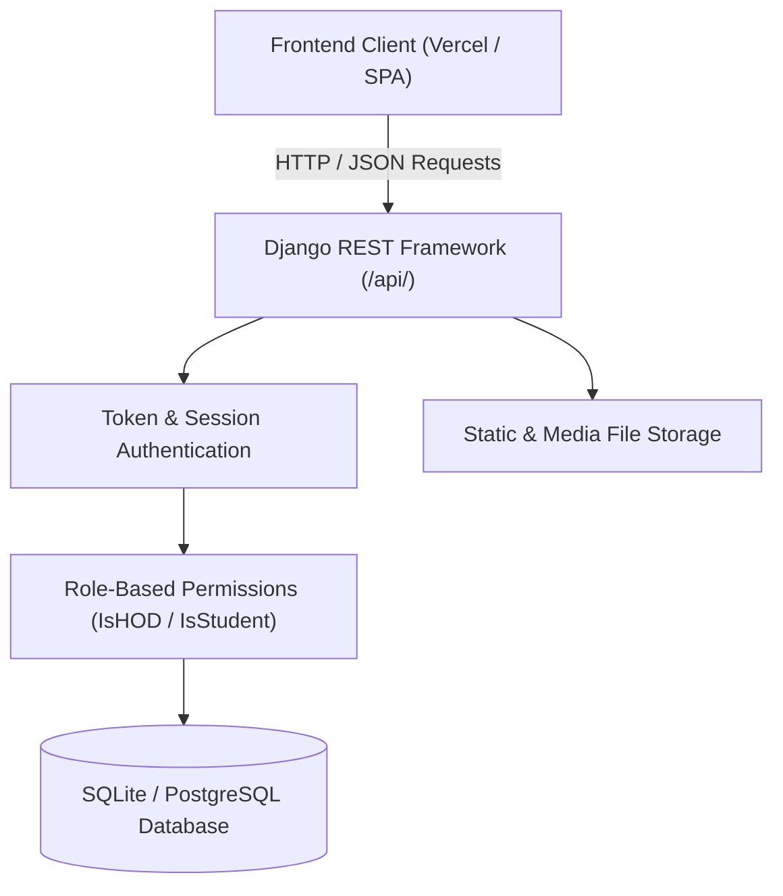

# ACADEX — Professional Student–HOD Academic Management Portal


ACADEX is an enterprise-grade academic SaaS portal designed for universities and colleges to streamline interactions, administration, and record management between **Students** and the **Head of Department (HOD)**.

Built with a secure **Django REST Framework** backend, an atomic role-based permission system, and a modern, responsive, zero-dependency client application ready for instant deployment on **Vercel**.

---

## 📌 Table of Contents
1. [Project Objectives](#-project-objectives)
2. [Core Features](#-core-features)
   - [Student Module](#1-student-module)
   - [HOD Module](#2-hod-module)
3. [System Architecture](#-system-architecture)
4. [Technology Stack](#-technology-stack)
5. [Brand & UI/UX Design System](#-brand--uiux-design-system)
6. [Local Installation & Setup](#-local-installation--setup)
   - [Prerequisites](#prerequisites)
   - [Backend Setup (Django)](#backend-setup)
   - [Database Seeding](#database-seeding)
   - [Frontend Setup & Launch](#frontend-setup)
7. [API Documentation](#-api-documentation)
8. [Automated Testing](#-automated-testing)
9. [Production Deployment Guide (Vercel)](#-production-deployment-guide-vercel)
10. [Default Demo Credentials](#-default-demo-credentials)
11. [License & Acknowledgments](#-license--acknowledgments)

---

## 🎯 Project Objectives
- **Eliminate Fragmented Academic Workflows:** Unify daily attendance, timetable scheduling, document verification, assignment submissions, internal assessment test marks, and leave applications into one unified platform.
- **Enforce Backend Role-Based Security:** Prevent unauthorized student access to departmental management endpoints with robust server-side permission gates (`IsHOD`, `IsStudent`, `IsOwnerOrHOD`).
- **Provide Actionable Academic Analytics:** Give HODs real-time visibility into attendance compliance (automated <75% shortage alert watchlist), batch attendance logging, and assignment evaluation metrics.
- **High-Performance & Lightweight Architecture:** Pure CSS variables, modern SVG icon library, and RESTful JSON APIs for sub-second response times and zero build-step fragility.

---

## 🚀 Core Features

### 1. Student Module
1. **Academic Profile:** Personal information, official register number, department, year, section, address, contact, and enrollment status.
2. **Attendance Management:**
   - Real-time cumulative attendance percentage gauge with 75% eligibility warning indicators.
   - Subject-wise attendance breakdown (Conducted vs. Attended).
   - Chronological daily period log with status filtering (Present, Absent, On Duty, Late).
3. **Weekly Timetable:** Interactive visual schedule from Monday to Saturday, periods 1 through 6, listing subjects, lecture halls, and faculty names.
4. **Campus Notices & Circulars:** Direct notification feed published by HOD with priority tags (`URGENT`, `IMPORTANT`, `NORMAL`).
5. **Assignments & Coursework:**
   - Active deadline countdowns and problem statements.
   - Assignment submission modal with file upload and student notes.
   - View graded score, percentage, and faculty feedback remarks.
6. **Study Material Repository:** Filterable courseware and lecture notes library with file size and download actions.
7. **Document Vault:** Upload mandatory academic certificates (College ID, Marksheets, Transfer Certificate) and monitor review status (`PENDING`, `APPROVED`, `CORRECTION`, `REJECTED`).
8. **Leave & OD Management:** Submit leave requests (Medical, Casual, On Duty) with duration and reason; monitor live HOD decision and remarks.
9. **Internal Marks & Performance:** Continuous Assessment Test results (CAT 1, CAT 2, Model Exam, Assignment components) with auto-calculated total and letter grades.
10. **Notifications Inbox:** Mark-as-read inbox with real-time alerts on document reviews, leave approvals, and graded assignments.

### 2. HOD Module
1. **Executive Department Dashboard:**
   - Total enrolled student metrics, faculty counts, and average department attendance rate.
   - Actionable summary cards for pending leaves, document verification backlog, and active assignments.
   - Instant Attendance Shortage Watchlist highlighting all students below 75%.
2. **Student Directory & Management:**
   - Searchable student catalog by register number or name.
   - Filter students by academic year (1st, 2nd, 3rd, 4th) and section (A, B).
   - 360-degree student dossier modal with contact details, academic standing, and history.
   - Register new students into the departmental roster.
3. **Batch Attendance Marking:**
   - Select subject, section, session date, and period.
   - One-click bulk status toggling (`Present`, `Absent`, `OD`, `Late`) with a "Mark All Present" shortcut.
   - Synchronized database recording and audit logging.
4. **Master Timetable Editor:** Configure and modify weekly class periods, assigned faculty, and room allocation.
5. **Announcement Publisher:** Create targeted notices with audience filtering (`ALL`, `DEPARTMENT`, `YEAR`, `SECTION`) and priority levels.
6. **Assignment Creation & Grading:**
   - Publish new assignment briefs with due dates and maximum scores.
   - Inspect student submissions and download student code/files.
   - Score submissions, attach feedback comments, and notify students instantly.
7. **Study Material Publisher:** Upload departmental lecture notes and course reference materials.
8. **Leave & OD Approvals:** Review student leave applications; approve with 1 click or reject with required feedback comments.
9. **Internal Marks Entry:** Enter and update student marks for midterms and model examinations per subject.
10. **System Audit Trail:** Immutable logging of critical actions (HOD logins, approvals, marks entry, and announcements).

---

## 🏗 System Architecture



---

## 💻 Technology Stack

| Layer | Technologies |
|---|---|
| **Backend Framework** | Python 3.14 / 3.15, Django 6.1.2 |
| **API Architecture** | Django REST Framework 3.18.3, Token Authentication |
| **Database** | SQLite (Development) / PostgreSQL-ready |
| **Frontend Client** | HTML5, Modern CSS3 Design Tokens, ES6 Modular JavaScript |
| **Icons & Visuals** | Crisp inline SVG Icon Library (Zero external network requests) |
| **Deployment Target** | Frontend: Vercel (`vercel.json`) • Backend: Railway / Render / AWS |

---

## 🎨 Brand & UI/UX Design System
- **Color Palette:**
  - **Primary Navy:** `#0f172a` (Headers, branding, active states)
  - **Secondary Navy:** `#1e293b` (Sidebar surface, cards)
  - **Accent Indigo:** `#4f46e5` / `#6366f1` (Call-to-actions, active links, badges)
  - **Neutral Light:** `#f8fafc` / `#ffffff` (App background, card surfaces)
  - **Semantic Accents:** Emerald Green (`#059669`), Amber (`#d97706`), Rose Red (`#dc2626`), Sky Blue (`#0284c7`)
- **Typography:** `Inter`, -apple-system, system-ui sans-serif stack.
- **Responsiveness:** Full viewport responsiveness with mobile drawer navigation, sticky top bar, horizontal table scrolling, and accessible modals.

---

## ⚙️ Local Installation & Setup

### Prerequisites
- Python 3.14 or 3.15 installed.
- Git installed.

### Backend Setup
1. Clone the repository:
   ```bash
   git clone https://github.com/akash2025it-gif/ACADEX.git
   cd ACADEX/ACADEX/backend
   ```
2. Activate your virtual environment:
   ```powershell
   # Windows PowerShell
   ..\virtual\Scripts\activate
   ```
3. Apply database migrations:
   ```bash
   python manage.py migrate
   ```
4. Run the development server:
   ```bash
   python manage.py runserver 127.0.0.1:8000
   ```
   Backend will be accessible at: `http://127.0.0.1:8000/api/`

### Database Seeding
To populate realistic demonstration records (HOD account, 6 student profiles, attendance history, timetable slots, assignments, notices, marks):
```bash
python seed_data.py
```

### Frontend Setup
The frontend is completely modular and requires zero compilation or build steps:
1. Navigate to `ACADEX/frontend/`.
2. Open `index.html` directly in any web browser, or serve it using any HTTP server:
   ```bash
   # Using Python's built-in HTTP server
   cd ACADEX/frontend
   python -m http.server 3000
   ```
3. Visit `http://localhost:3000` in your browser.

---

## 🔐 Demonstration & Default Account Roles

| Role | Username / Identifier | Initial Setup | Access Permissions |
|---|---|---|---|
| **Head of Department (HOD)** | `hod_it` (or `HOD-IT-01`) | Configured via `seed_data.py` / `.env` | Department Administration & Faculty Oversight |
| **Student (Alex Johnson)** | `25IT104` | Configured via `seed_data.py` / `.env` | Student Academic Portal (Year 3, Sec B) |
| **Student (Priya Sharma)** | `25IT105` | Configured via `seed_data.py` / `.env` | Student Academic Portal (Year 3, Sec B) |
| **Student (Rahul Varma)** | `25IT106` | Configured via `seed_data.py` / `.env` | Student Academic Portal (Shortage <75%) |

> **Security Note:** In accordance with production security standards, passwords must be securely configured via the `DEMO_USER_PASSWORD` environment variable before executing `python seed_data.py`, or created interactively using `python manage.py createsuperuser`. Never commit plaintext passwords to version control.
>
> *For development and evaluation, the login interface also provides 1-click **Demo Student** and **Demo HOD** buttons.*

---

## 📡 API Documentation

### Authentication & Profile
- `POST /api/auth/login/` — Authenticate and receive DRF Token.
- `POST /api/auth/register-student/` — Create new student account.
- `POST /api/auth/logout/` — Invalidate authentication session.
- `GET /api/auth/profile/` — Fetch current user and nested profile.
- `PATCH /api/auth/profile/` — Update contact/personal info.
- `POST /api/auth/change-password/` — Secure password update.

### Academic Operations
- `GET/POST /api/announcements/` — List or publish notices.
- `GET /api/attendance/summary/` — Student attendance percentage & subject metrics.
- `GET /api/attendance/history/` — Chronological daily attendance log.
- `POST /api/attendance/mark/` — HOD batch attendance recording.
- `GET /api/attendance/department-analytics/` — Department attendance analytics & shortage list.
- `GET/POST /api/timetable/` — View or manage timetable slots.
- `GET/POST /api/assignments/` — View or create assignments.
- `POST /api/assignments/<id>/submit/` — Submit student work for assignment.
- `GET /api/assignments/<id>/submissions/` — HOD submission review.
- `POST /api/assignments/submissions/<id>/grade/` — Score and grade submission.
- `GET/POST /api/study-materials/` — View or upload course materials.
- `GET/POST /api/documents/` — Upload or inspect verified student documents.
- `POST /api/documents/<id>/review/` — HOD approve/reject document.
- `GET/POST /api/leaves/` — Apply for leave or list leave requests.
- `POST /api/leaves/<id>/review/` — HOD approve or reject leave application.
- `GET /api/marks/my-marks/` — Student Continuous Assessment Test results.
- `GET/POST /api/marks/` — HOD marks entry & summary.
- `GET /api/department/overview/` — HOD KPI metrics.
- `GET /api/department/students/` — Filterable student directory.

---

## 🧪 Automated Testing

ACADEX includes automated unit and integration tests covering authentication, permission barriers, business logic, leave workflows, and marks calculation:

```bash
cd ACADEX/backend
python manage.py test beacadex
```

Output:
```
Creating test database for alias 'default'...
........
----------------------------------------------------------------------
Ran 8 tests in 29.101s

OK
Destroying test database for alias 'default'...
```

---

## 🌐 Production Deployment Guide (Vercel)

The frontend is packaged with `vercel.json` configured for single-page routing:
1. In Vercel, import the GitHub repository: `https://github.com/akash2025it-gif/ACADEX`.
2. Set the **Root Directory** to `ACADEX/frontend`.
3. In Project Settings > Environment Variables, configure:
   - `ACADEX_API_URL`: URL of your hosted Django backend (e.g., `https://acadex-backend.up.railway.app/api`).
4. Click **Deploy**. Vercel will deploy the frontend instantly with SSL and worldwide CDN caching.

---

## 📄 License & Acknowledgments
Developed by **Akash G** for the **ACADEX Academic Management Platform**. Built with Python, Django REST Framework, and modern web standards.
